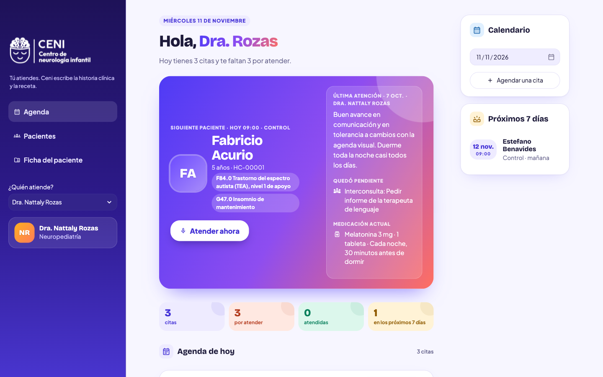
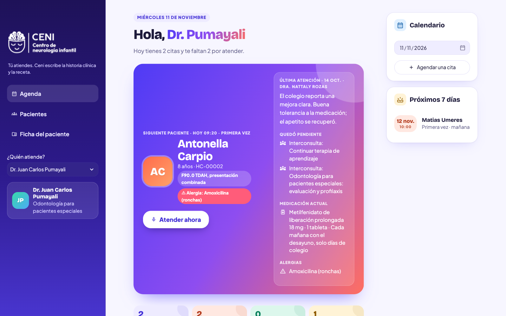
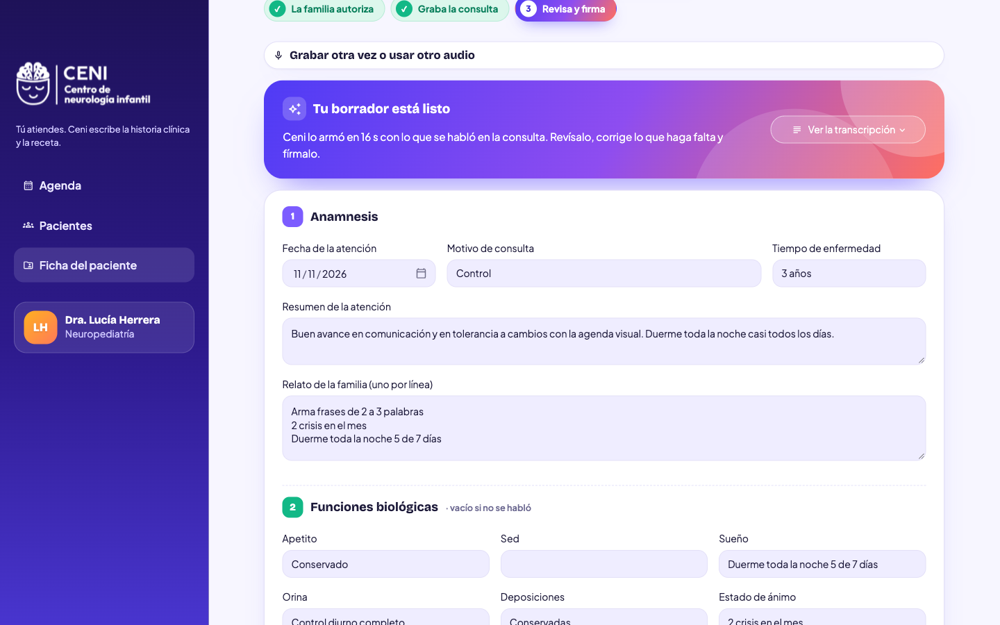
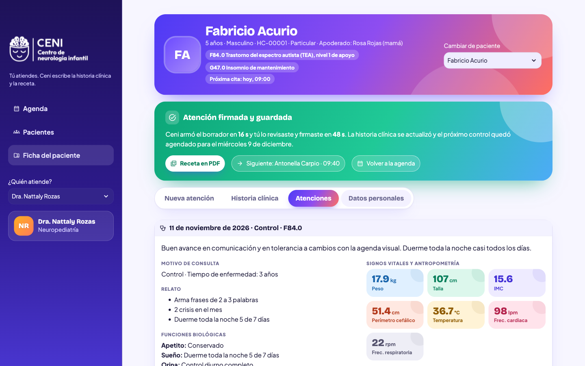
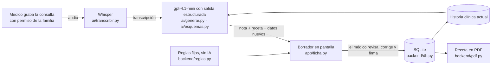

# Ceni

**Hacemos la historia clínica, la nota de atención y la receta para neuropediatras que atienden a niños con TEA y TDAH, mediante la grabación de la consulta, Whisper y un LLM con salidas estructuradas.**

El médico revisa, corrige y firma: **Ceni documenta, no diagnostica.** Todos los pacientes de este repositorio son inventados.



---

## 1. One-liner

Hacemos la historia clínica, la nota de atención y la receta para neuropediatras que atienden a niños con TEA y TDAH, mediante la grabación de la consulta, Whisper y un LLM con salidas estructuradas.

## 2. Founder

> **Pendiente (lo escribe Melina):** quién soy y por qué soy la persona indicada para este problema.

## 3. Problema

**Quién lo sufre.** Los neuropediatras que atienden a niños con TEA y TDAH, en consulta privada y en hospital. A otros profesionales que atienden niños en el mismo centro les pasa lo mismo, por ejemplo a pediatras y odontólogos.

**Cuánto le cuesta.** Datos de las 3 conversaciones:
- **Cada día, fuera de la consulta:** de 5 a 10 minutos extra por paciente para terminar la historia. Con 10 a 12 pacientes al día, son **entre 50 minutos y 2 horas diarias** ([entrevista 1](docs/research/entrevista-1.md)).
- **Primeras consultas e informes:** de 15 a 20 minutos extra por cada primera historia, y **media hora o más por cada informe** ([entrevista 3](docs/research/entrevista-3.md)).
- **Fuera de horario:** «Hay días en que termino saliendo tarde por eso» (entrevista 1). Los informes se hacen «en casa» (entrevista 3). «Termino el día cansadísima y todavía tengo que completar historias» ([entrevista 2](docs/research/entrevista-2.md)).
- **Durante la consulta:** «Si estoy escribiendo, no puedo prestarles toda la atención que quisiera» (entrevista 3). El costo también lo paga la familia.

**Cómo lo resuelven hoy.** Escriben durante la consulta y completan después:
- en un sistema básico del consultorio;
- en Word, un archivo por paciente;
- en papel y Excel;
- o en la historia electrónica del hospital, que «no siempre funciona como uno quisiera».

Si una familia pierde la receta, la piden de nuevo por WhatsApp.

**Lo que les preocupa:**
- que la IA se equivoque en medicamentos o dosis;
- que «complete cosas que yo no he dicho»;
- la autorización de los padres para grabar;
- la confidencialidad, porque son menores de edad.

Por eso en Ceni el médico revisa y firma, los campos que no se dijeron quedan vacíos, la grabación necesita la autorización de la familia y el audio no se guarda.

| | [Entrevista 1](docs/research/entrevista-1.md) | [Entrevista 2](docs/research/entrevista-2.md) | [Entrevista 3](docs/research/entrevista-3.md) |
|---|---|---|---|
| **Quién** | Pediatría, consultorio | Odontóloga, consultorio privado | Neuropediatra, hospital y consulta privada |
| **Pacientes al día** | 10 a 12 | 6 a 8 | 12 a 16 por turno en el hospital; 5 o 6 en privado |
| **Tiempo extra para documentar** | 5 a 10 min por paciente | 5 a 10 min por evolución | 15 a 20 min por primera historia; 30 min o más por informe |
| **Cómo registra hoy** | Sistema básico del consultorio | Papel y Excel | Historia electrónica en el hospital; Word en privado |
| **¿La usaría?** | Sí, si es fácil | Sí, si puede dictar al terminar | Sí, sobre todo en primeras consultas |
| **Pagaría al mes** | S/ 80 a 100 | S/ 40 a 50 para probar | S/ 120 a 150 |

## 4. Solución e insight

**Solución.** Con el permiso de la familia, el neuropediatra graba la consulta completa, sin cambiar su forma de atender. Ceni:

1. **Transcribe** la conversación con Whisper.
2. **Arma el borrador** con un LLM y salidas estructuradas. Con una sola llamada salen tres cosas:
   - la nota de atención, con los campos del formato de consulta externa del MINSA (anamnesis, funciones biológicas, signos vitales, examen, diagnósticos CIE-10 y plan de trabajo);
   - la receta, solo con lo que el médico dijo;
   - los datos nuevos para la historia clínica.
3. **Junta los datos nuevos** con la historia clínica sin borrar nada de lo anterior.
4. **Avisa** con reglas fijas, sin IA, cuando un medicamento necesita receta especial de psicotrópicos o cuando choca con una alergia registrada.
5. **Espera la firma del médico.** Él revisa, corrige y firma. Recién entonces se guarda, se agenda el próximo control y sale la receta en PDF.

Antes de cada paciente, Ceni muestra lo que el médico necesita recordar: qué pasó en la última atención, qué quedó pendiente, la medicación actual y las alergias.

**Un centro, varios profesionales.** En la barra lateral se elige quién atiende: la neuropediatra o el odontólogo para pacientes especiales. Cada uno tiene su agenda y firma sus atenciones, pero la historia clínica del niño es una sola. Así el odontólogo ve la medicación, las alergias y la derivación que dejó la neuropediatra antes de atenderlo.



> **Insight. Pendiente (lo escribe Melina):** lo que entendí del problema que otros no ven.

## 5. Why now

- **Transcribir en español ya es barato y bueno.** Whisper salió en 2022 y su API en 2023. Hoy transcribir una consulta de 20 minutos cuesta unos US$ 0.12.
- **La IA ya puede llenar un formulario, no solo escribir texto.** Desde agosto de 2024, las salidas estructuradas de OpenAI garantizan que la respuesta tenga exactamente los campos del esquema. Por eso la nota cae en los campos de la historia clínica y no en un párrafo suelto.
- **Los modelos pequeños cuestan menos de un centavo por consulta.** gpt-4.1-mini (2025) arma la nota, la receta y los datos nuevos por menos de US$ 0.01.

> **Pendiente (lo completa Melina):** el contexto del Perú y de los neuropediatras que explica por qué ahora.

## 6. Demo

**URL pública:** https://ceni-demo.streamlit.app/ (Streamlit Community Cloud)

**Cómo correrlo en tu laptop:**

```bash
uv venv --python 3.12 .venv
uv pip install --python .venv/bin/python -r requirements.txt
cp .env.example .env   # y pega tu OPENAI_API_KEY dentro
.venv/bin/streamlit run streamlit_app.py
```

- Para volver a los datos del demo, abre la app con `?reiniciar` al final de la URL. Por ejemplo: `http://localhost:8501/?reiniciar`.
- Para probar sin micrófono, los guiones de dos consultas inventadas están en [`data/audios_demo/guiones.md`](data/audios_demo/guiones.md). También se puede pegar el texto de la consulta.

### Capturas

| 1. Agenda | 2. Borrador listo para revisar | 3. Atención firmada |
|---|---|---|
|  |  |  |
| El siguiente paciente, con lo que quedó pendiente y su medicación. | Ceni llena la nota con los campos del MINSA y el médico corrige. | Tiempos medidos, la receta en PDF y el paso al siguiente paciente. |

Todos los datos son inventados. En las capturas 2 y 3 se usó un borrador de prueba, armado sin llamar a la IA.

### Arquitectura



| Carpeta | Qué hace |
|---|---|
| `streamlit_app.py` | Entrada de la app: clave, base de datos, estilo, barra lateral y páginas. |
| `app/` | Las pantallas: agenda, pacientes y ficha del paciente (`ficha.py` tiene el flujo de grabar, revisar y firmar). |
| `ai/` | La IA: `transcribir.py` (Whisper), `generar.py` (LLM), `esquemas.py` (los campos que debe devolver) y `prompts.py`. |
| `backend/` | La base SQLite (`db.py`), las reglas de la receta (`reglas.py`) y el PDF (`pdf.py`). |
| `data/` | `semilla.json` con los pacientes inventados. La base `ceni.db` se crea sola al arrancar. |
| `docs/` | Entrevistas, benchmark de la competencia y capturas. |

### Modelos y APIs, y por qué

| Pieza | Qué usamos | Por qué |
|---|---|---|
| Voz a texto | **whisper-1** (OpenAI) | Es buena en español y cuesta US$ 0.006 por minuto. Le pasamos los nombres del paciente y de sus medicamentos para que los escriba bien. Si la consulta es larga, el audio se parte en trozos de 10 minutos que se transcriben a la vez. |
| De texto a datos | **gpt-4.1-mini** con salidas estructuradas (`chat.completions.parse` + Pydantic) | Es rápido y barato, y respeta el esquema. Usa temperatura 0.2 para ser fiel a lo dicho y no inventar. Se cambia con `OPENAI_MODEL` sin tocar el código. |
| Reglas de la receta | Python, sin IA | Las alertas de psicotrópicos y alergias deben ser fijas y explicables. |
| Interfaz | Streamlit | Es una sola app en Python y se despliega gratis en Streamlit Community Cloud. |
| Datos | SQLite | Basta para el demo. En producción iría una base con respaldo y cifrado. |
| PDF | fpdf2 | La receta con los campos que pide la Ley 29459. |

**Privacidad y seguridad:**
- El audio no se guarda. Antes de grabar, la familia tiene que dar su permiso, y queda registrada la hora.
- La clave de OpenAI va en `.env` en la laptop y en Secrets en la nube. Nunca se sube al repo.
- Hay dos límites para cuidar el saldo de la API: 10 transcripciones por paciente cada 7 días y 20 usos de IA por visitante de la URL pública.

## 7. Modelo de negocio

> **Pendiente (lo escribe Melina):** quién paga (el médico, la clínica o el centro) y el precio concreto al mes.

**Cuánto nos cuesta cada usuario.** Es una estimación hecha con el tamaño real del prompt y del esquema que están en el código. Se ajustará con el panel de uso de OpenAI después de las primeras consultas reales.

| Supuesto | Valor |
|---|---|
| Duración de una consulta | 20 minutos |
| Consultas por médico | 12 al día, 22 días al mes, unas 264 al mes (como en la entrevista 1) |
| Entrada al LLM por consulta | unos 8,000 tokens: instrucciones, esquema, historia y transcripción |
| Salida del LLM por consulta | unos 1,500 tokens: nota, receta y datos nuevos |

| Costo | Por consulta | Por médico al mes |
|---|---:|---:|
| Whisper: 20 min × US$ 0.006 | US$ 0.120 | US$ 31.7 |
| gpt-4.1-mini, entrada: 8,000 × US$ 0.40 por millón | US$ 0.003 | US$ 0.8 |
| gpt-4.1-mini, salida: 1,500 × US$ 1.60 por millón | US$ 0.002 | US$ 0.6 |
| **Total de IA** | **≈ US$ 0.13** | **≈ US$ 33** |
| Servidor | Streamlit Community Cloud es gratis para el demo. En producción, un servidor pequeño de US$ 10 a 25 al mes se reparte entre todos los médicos. | — |

- **El 95% del costo es la transcripción.** Si se cambia a `gpt-4o-mini-transcribe` (US$ 0.003 por minuto), el costo baja a unos US$ 0.07 por consulta, unos US$ 17 por médico al mes.
**Datos para decidir el precio.** Se compara el costo de IA de cada perfil de las entrevistas con lo que dijo que pagaría. El tipo de cambio de referencia es S/ 3.75 por dólar.

| Perfil (entrevista) | Uso al mes | Costo de IA con whisper-1 | Con gpt-4o-mini-transcribe | Pagaría |
|---|---|---:|---:|---:|
| Pediatría (1): 12 consultas de 20 min al día | 5,280 min de audio | ≈ S/ 124 | ≈ S/ 65 | S/ 80 a 100 |
| Neuropediatría privada (3): 6 consultas de 30 min al día | 3,960 min de audio | ≈ S/ 92 | ≈ S/ 47 | S/ 120 a 150 |
| Odontología (2): dictado de 2 min al terminar, 8 pacientes al día | 352 min de audio | ≈ S/ 12 | ≈ S/ 8 | S/ 40 a 50 |

Con whisper-1, el plan de pediatría pierde plata. El de neuropediatría y el de dictado dejan margen. Por eso el precio debería ir por perfil o por minutos, y conviene cambiar a un modelo de transcripción más barato.

- **Las cuentas cambian si cambian los precios.** Son precios de lista de OpenAI de noviembre de 2026. Algunas fuentes dicen que whisper-1 se retirará de la API en 2027: hay que revisar la página de deprecaciones de OpenAI.

## 8. Herramientas del curso

| Herramienta | Sesión | Archivos | Por qué esta |
|---|---|---|---|
| **De la voz al texto con Whisper** | 13 | [`ai/transcribir.py`](ai/transcribir.py) | Lo que el médico necesita documentar está en una conversación. Mientras atiende a un niño no puede escribir, y dictar después le quita el mismo tiempo. Grabar la consulta no cambia su forma de trabajar. |
| **LLMs con salidas estructuradas** | 08 | [`ai/generar.py`](ai/generar.py), [`ai/esquemas.py`](ai/esquemas.py), [`ai/prompts.py`](ai/prompts.py) | Una historia clínica no es un resumen: son campos (diagnósticos CIE-10, signos vitales, medicamentos con dosis). El esquema obliga al modelo a devolver esos campos. Pydantic los valida y `fusionar_historia` (en `esquemas.py`) agrega lo nuevo sin borrar lo anterior. |

## 9. Qué hizo el agente

Este proyecto se construyó con **Claude Code** (Claude, de Anthropic).

**Lo que generó el agente:**
- casi todo el código de `app/`, `ai/`, `backend/` y `streamlit_app.py`;
- los pacientes inventados de `data/semilla.json` y los guiones de `data/audios_demo/`;
- el benchmark de la competencia ([`docs/benchmark.md`](docs/benchmark.md));
- el diseño visual (`app/estilo.py`, `.streamlit/config.toml`);
- las pruebas sin navegador de cada pantalla;
- las capturas y las secciones 6, 8 y 9 de este README, y el cálculo de costos de la sección 7.

**Lo que decidí yo (Melina):**
- el problema y el usuario: el neuropediatra que atiende a niños con TEA y TDAH;
- el alcance: grabar la consulta y obtener la historia clínica, la nota y la receta para que el médico revise y firme. Descarté el plan de objetivos, los gráficos de evolución y el informe para los padres;
- seguir el formato de consulta externa del MINSA;
- el límite de 10 transcripciones por paciente cada 7 días;
- sumar al odontólogo para pacientes especiales, con su propia agenda y la misma historia clínica;
- la marca y el pedido de rediseño;
- las entrevistas con usuarios y la revisión del código para poder explicarlo y cambiarlo.

## Opcional

- **Competencia:** [docs/benchmark.md](docs/benchmark.md) compara Ceni con plataformas de historia clínica, citas y notas con IA.
