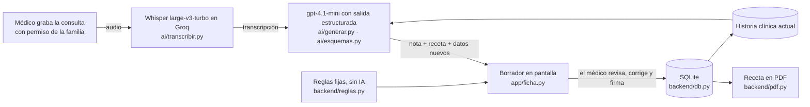

# Ceni

**Hacemos la historia clínica, la nota de atención y la receta para neuropediatras que atienden a niños con TEA y TDAH, mediante la grabación de la consulta, Whisper y un LLM con salidas estructuradas.**

El médico revisa, corrige y firma: **Ceni documenta, no diagnostica.** Todos los pacientes de este repositorio son inventados.


---

## 1. One-liner

Hacemos la historia clínica, la nota de atención y la receta para neuropediatras que atienden a niños con TEA y TDAH, mediante la grabación de la consulta, Whisper y un LLM con salidas estructuradas.

## 2. Founder

**Melina Rozas.** Soy especialista en producto digital, con más de 6 años construyendo productos en retail, telecomunicaciones y startups. Estudio la Diplomatura de Ciencia de Datos para las Ciencias Sociales y la Gestión Pública (Q-Lab PUCP).

**Por qué yo:** mi hermana está abriendo un centro de neurología infantil con 3 sedes, y yo diseño sus sistemas, la web y el gestor de citas, junto al equipo de desarrollo. Ahí vi de cerca cuánto tiempo se va en documentar cada consulta. Sé convertir un problema en un producto, y ese centro es el primer lugar para probar Ceni.

**Cómo cubro todo sola:**
- **Producto y diseño:** son mi oficio.
- **Ingeniería:** la hago con un agente de IA (Claude Code), revisando y entendiendo cada parte del código.
- **Ventas:** empiezan por el centro de mi hermana y por los profesionales que entrevisté.

## 3. Problema

**Quién lo sufre.** Los neuropediatras que atienden a niños con TEA y TDAH, en consulta privada y en hospital. A otros profesionales que atienden niños en el mismo centro les pasa lo mismo, por ejemplo a pediatras y odontólogos.

**Cuánto le cuesta.** Datos de las 3 conversaciones:
- **Cada día, fuera de la consulta:** de 5 a 10 minutos extra por paciente para terminar la historia. Con 10 a 12 pacientes al día, son **entre 50 minutos y 2 horas diarias** ([entrevista 1](docs/research/entrevista-1.md)).
- **Primeras consultas e informes:** de 15 a 20 minutos extra por cada primera historia, y **media hora o más por cada informe** ([entrevista 3](docs/research/entrevista-3.md)).
- **Fuera de horario:** «Hay días en que termino saliendo tarde por eso» (entrevista 1). Los informes se hacen «en casa» (entrevista 3). «Termino el día cansadísima y todavía tengo que completar historias» ([entrevista 2](docs/research/entrevista-2.md)).
- **Durante la consulta:** «Si estoy escribiendo, no puedo prestarles toda la atención que quisiera» (entrevista 3). El costo también lo paga la familia.

**Cómo lo resuelven hoy.** Escriben durante la consulta y completan después:
- en un sistema básico del consultorio;
- en Word, un archivo por paciente;
- en papel y Excel;
- o en la historia electrónica del hospital, que «no siempre funciona como uno quisiera».

Si una familia pierde la receta, la piden de nuevo por WhatsApp.

**Lo que les preocupa:**
- que la IA se equivoque en medicamentos o dosis;
- que «complete cosas que yo no he dicho»;
- la autorización de los padres para grabar;
- la confidencialidad, porque son menores de edad.

Por eso en Ceni el médico revisa y firma, los campos que no se dijeron quedan vacíos, la grabación necesita la autorización de la familia y el audio no se guarda.

| | [Entrevista 1](docs/research/entrevista-1.md) | [Entrevista 2](docs/research/entrevista-2.md) | [Entrevista 3](docs/research/entrevista-3.md) |
|---|---|---|---|
| **Quién** | Pediatría, consultorio | Odontóloga, consultorio privado | Neuropediatra, hospital y consulta privada |
| **Pacientes al día** | 10 a 12 | 6 a 8 | 12 a 16 por turno en el hospital; 5 o 6 en privado |
| **Tiempo extra para documentar** | 5 a 10 min por paciente | 5 a 10 min por evolución | 15 a 20 min por primera historia; 30 min o más por informe |
| **Cómo registra hoy** | Sistema básico del consultorio | Papel y Excel | Historia electrónica en el hospital; Word en privado |
| **¿La usaría?** | Sí, si es fácil | Sí, si puede dictar al terminar | Sí, sobre todo en primeras consultas |
| **Pagaría al mes** | S/ 80 a 100 | S/ 40 a 50 para probar | S/ 120 a 150 |

## 4. Solución e insight

**Solución.** Con el permiso de la familia, el neuropediatra graba la consulta completa, sin cambiar su forma de atender. Ceni:

1. **Transcribe** la conversación con Whisper.
2. **Arma el borrador** con un LLM y salidas estructuradas. Con una sola llamada salen tres cosas:
   - la nota de atención, con los campos del formato de consulta externa del MINSA (anamnesis, funciones biológicas, signos vitales, examen, diagnósticos CIE-10 y plan de trabajo);
   - la receta, solo con lo que el médico dijo;
   - los datos nuevos para la historia clínica.
3. **Junta los datos nuevos** con la historia clínica sin borrar nada de lo anterior.
4. **Avisa** con reglas fijas, sin IA, cuando un medicamento necesita receta especial de psicotrópicos o cuando choca con una alergia registrada.
5. **Espera la firma del médico.** Él revisa, corrige y firma. Recién entonces se guarda, se agenda el próximo control y sale la receta en PDF.
6. **Mide cuánto acertó.** Al firmar, compara su borrador con lo que firmó el médico, dato por dato, sin usar IA. El médico sabe qué se dijo, así que lo que firma es la respuesta correcta. Muestra algo como «Ceni acertó 21 de 24 datos (88%): corregiste 1, agregaste 1, borraste 1». En la agenda se ve el acierto de los últimos 30 días ([`backend/acierto.py`](backend/acierto.py)).

Antes de cada paciente, Ceni muestra lo que el médico necesita recordar: qué pasó en la última atención, qué quedó pendiente, la medicación actual y las alergias.

**Hecho para muchos consultorios.** Ceni tiene tres niveles:
- **Admin (Melina):** da de alta cada consultorio, sus médicos y las plantillas de cada especialidad ([`app/admin.py`](app/admin.py)).
- **Consultorio:** tiene uno o varios médicos y solo ve sus propios pacientes.
- **Médico:** tiene su agenda, firma sus atenciones y ve en «Mis métricas» cuánto tarda Ceni, cuánto tarda él en revisar y cuánto acierta Ceni ([`app/metricas.py`](app/metricas.py)).

**Una sola historia clínica para todas las especialidades.** Todas comparten el formato de consulta externa del MINSA. La plantilla de cada especialidad (neurología, odontología, dermatología…) solo le suma sus campos propios, y la IA también los llena. En el demo, el odontólogo ve la alergia y la derivación que dejó la neuropediatra antes de atender al niño. Cada cita se agrega a Google Calendar con un clic, sin el nombre del paciente.


**Insight 1. La historia ya se dijo en voz alta.** Durante la consulta, la familia cuenta y el médico examina e indica: la historia clínica ya existe, pero hablada. Hoy se hace dos veces, una conversando y otra tecleando. Una pediatra lo dijo así: «Lo más pesado es tener que escribir lo mismo que ya estuve conversando durante toda la consulta». Ceni no le pide al médico que cambie su forma de atender: convierte en documento lo que ya se dijo.

**Insight 2. La confianza se gana midiendo el error, no prometiendo que no existe.** Los tres entrevistados temen lo mismo: que la IA se equivoque en una dosis o «complete cosas que yo no he dicho». Por eso Ceni no promete ser perfecta. El médico firma todo, y Ceni le muestra en cada atención cuánto acertó y cuánto tuvo que corregir.

## 5. Why now

- **Transcribir en español ya es barato y bueno.** Whisper salió en 2022 y su API en 2023. Hoy transcribir una consulta de 20 minutos con Whisper cuesta poco más de un centavo de dólar (US$ 0.013 en Groq).
- **La IA ya puede llenar un formulario, no solo escribir texto.** Desde agosto de 2024, las salidas estructuradas de OpenAI garantizan que la respuesta tenga exactamente los campos del esquema. Por eso la nota cae en los campos de la historia clínica y no en un párrafo suelto.
- **Los modelos pequeños cuestan menos de un centavo por consulta.** gpt-4.1-mini (2025) arma la nota, la receta y los datos nuevos por menos de US$ 0.01.

**Y en el Perú:**
- **La demanda crece:** en 2025, el MINSA reportó **96,512 casos de TEA atendidos** y **764,860 atenciones** en sus establecimientos ([MINSA](https://www.gob.pe/institucion/minsa/noticias/1372211-minsa-promueve-la-deteccion-temprana-del-autismo-y-registro-mas-de-764-000-atenciones-por-tea)). Cada una genera una historia, una nota y muchas veces una receta.
- **El Estado empuja la historia clínica electrónica:**
  - En 2013, la **Ley 30024** creó el Registro Nacional de Historias Clínicas Electrónicas (RENHICE).
  - En 2025 se modificó su reglamento ([D. S. 020-2025-SA](https://lpderecho.pe/modifican-reglamento-ley-crea-registro-nacional-historias-clinicas-electronicas-renhice-decreto-supremo-020-2025-sa/)), y el MINSA reguló la acreditación de los sistemas de historia clínica electrónica ([R. M. 164-2025-MINSA](https://lpderecho.pe/minsa-regula-acreditacion-sistemas-historias-clinicas-electronicas-resolucion-ministerial-164-2025-minsa)).
- **La práctica va atrás:** los consultorios siguen en Word, papel, Excel o sistemas básicos, como contaron las 3 personas entrevistadas. Ceni usa los campos del formato de consulta externa del MINSA desde el inicio.

## 6. Demo

**URL pública:** https://ceni-demo.streamlit.app/ (Streamlit Community Cloud)

**Cómo correrlo en tu laptop:**

```bash
uv venv --python 3.12 .venv
uv pip install --python .venv/bin/python -r requirements.txt
cp .env.example .env   # y pega tu OPENAI_API_KEY y tu GROQ_API_KEY dentro
.venv/bin/streamlit run streamlit_app.py
```

- En la barra lateral, «Entrar como» elige quién usa la app: el admin o un médico de cualquiera de los dos consultorios del demo. En producción, esto sería un inicio de sesión.
- Para volver a los datos del demo, abre la app con `?reiniciar` al final de la URL. Por ejemplo: `http://localhost:8501/?reiniciar`.
- Para probar sin micrófono, los guiones de dos consultas inventadas están en [`data/audios_demo/guiones.md`](data/audios_demo/guiones.md). También se puede pegar el texto de la consulta.

### Capturas

| 1. Agenda | 2. Borrador listo para revisar | 3. Atención firmada |
|---|---|---|
|  |  |  |
| El siguiente paciente, con lo que quedó pendiente y su medicación. | Ceni llena la nota con los campos del MINSA y el médico corrige. | Tiempos medidos, la receta en PDF y el paso al siguiente paciente. |

Todos los datos son inventados. En las capturas 2 y 3 se usó un borrador de prueba, armado sin llamar a la IA.

### Arquitectura



| Carpeta | Qué hace |
|---|---|
| `streamlit_app.py` | Entrada de la app: clave, base de datos, estilo, barra lateral y páginas. |
| `app/` | Las pantallas: agenda, pacientes, ficha del paciente (`ficha.py` tiene el flujo de grabar, revisar y firmar), mis métricas y el panel de admin. |
| `ai/` | La IA: `transcribir.py` (Whisper), `generar.py` (LLM), `esquemas.py` (los campos que debe devolver) y `prompts.py`. |
| `backend/` | La base SQLite (`db.py`), las reglas de la receta (`reglas.py`), el PDF (`pdf.py`) y el acierto de Ceni (`acierto.py`). |
| `data/` | `semilla.json` con los pacientes inventados. La base `ceni.db` se crea sola al arrancar. |
| `docs/` | Entrevistas, benchmark de la competencia y capturas. |

### Modelos y APIs, y por qué

| Pieza | Qué usamos | Por qué |
|---|---|---|
| Voz a texto | **Whisper large-v3-turbo** en Groq (respaldo: **whisper-1** de OpenAI) | Es Whisper, con un costo de US$ 0.04 por hora de audio: unas 9 veces menos que whisper-1. OpenAI dice que el turbo rinde parecido a large-v2 en la mayoría de idiomas. Le pasamos los nombres del paciente y de sus medicamentos para que los escriba bien. Si Groq falla, la consulta se transcribe con whisper-1 y no se pierde. |
| De texto a datos | **gpt-4.1-mini** con salidas estructuradas (`chat.completions.parse` + Pydantic) | Es rápido y barato, y respeta el esquema. Usa temperatura 0.2 para ser fiel a lo dicho y no inventar. Se cambia con `OPENAI_MODEL` sin tocar el código. |
| Reglas de la receta | Python, sin IA | Las alertas de psicotrópicos y alergias deben ser fijas y explicables. |
| Interfaz | Streamlit | Es una sola app en Python y se despliega gratis en Streamlit Community Cloud. |
| Datos | SQLite | Basta para el demo. En producción iría una base con respaldo y cifrado. |
| PDF | fpdf2 | La receta con los campos que pide la Ley 29459. |

**Privacidad y seguridad:**
- El audio no se guarda. Antes de grabar, la familia tiene que dar su permiso, y queda registrada la hora.
- Las claves de OpenAI y Groq van en `.env` en la laptop y en Secrets en la nube. Nunca se suben al repo.
- Hay dos límites para cuidar el saldo de la API: 10 transcripciones por paciente cada 7 días y 20 usos de IA por visitante de la URL pública.

## 7. Modelo de negocio

**Quién paga.** El profesional, o el centro por sus profesionales («si el consultorio lo paga, mejor todavía», entrevista 1).

**Cuánto: se paga por uso, con un tope al mes.** Precios con IGV incluido:
- **S/ 0.50 por consulta grabada.**
- **S/ 0.25 por dictado corto** (menos de 5 minutos), como el del odontólogo al terminar un procedimiento.
- **Tope de S/ 99 al mes:** pasado el tope, el resto del mes no se cobra.

El profesional paga solo lo que usa y sabe de antemano lo máximo que va a pagar. El tope sale de lo que dijo la entrevista 1, que pagaría «unos 80 o 100 soles». Así quedan los tres perfiles de las entrevistas:

| Perfil (entrevista) | Uso al mes | Pagaría con esta tarifa | Dijo que pagaría |
|---|---|---:|---:|
| Pediatría (1) | 264 consultas de 20 min | S/ 99 (llega al tope) | S/ 80 a 100 |
| Neuropediatría privada (3) | 132 consultas de 30 min | S/ 66 | S/ 120 a 150 |
| Odontología (2) | 176 dictados de 2 min | S/ 44 | S/ 40 a 50 |

**Cuánto nos cuesta cada consulta.** Cada consulta usa una transcripción y una llamada al LLM. Es una estimación hecha con el tamaño real del prompt y del esquema que están en el código.

| Costo de una consulta de 20 minutos | Cálculo | US$ |
|---|---|---:|
| Transcripción con Whisper large-v3-turbo en Groq | 20 min × US$ 0.04 por hora | 0.013 |
| gpt-4.1-mini, entrada | ~8,150 tokens × US$ 0.40 por millón | 0.003 |
| gpt-4.1-mini, salida | ~1,500 tokens × US$ 1.60 por millón | 0.002 |
| **Total de IA** | | **≈ 0.019 (S/ 0.07)** |

Con whisper-1 de OpenAI la misma consulta costaba US$ 0.126 (S/ 0.47): la transcripción era el 95% del costo. Por eso Ceni transcribe en Groq, con el mismo Whisper, y deja whisper-1 solo como respaldo.

**Estructura de costos.** Tiene tres capas: lo que cuesta cada consulta, lo que deja cada profesional al mes y los costos fijos que hay que cubrir.

*1. Una consulta de 20 minutos, a S/ 0.50:*

| Concepto | S/ |
|---|---:|
| Precio con IGV | 0.500 |
| − IGV (18%, va a SUNAT) | −0.076 |
| **= Ingreso** | **0.424** |
| − Comisión de cobro (4% del precio) | −0.020 |
| − Transcripción: Whisper large-v3-turbo en Groq, 20 min | −0.050 |
| − Nota, receta e historia: gpt-4.1-mini | −0.021 |
| − Reprocesos: 10% de las consultas se vuelven a procesar | −0.007 |
| **= Margen de contribución** | **0.325 (77% del ingreso)** |

*2. Cada profesional al mes, con la tarifa y el tope:*

| Perfil (entrevista) | Paga | Ingreso sin IGV | Comisión | IA y reprocesos | Margen de contribución |
|---|---:|---:|---:|---:|---:|
| Pediatría (1): 264 consultas | S/ 99 | S/ 83.9 | S/ 4.0 | S/ 20.7 | **S/ 59.3 (71%)** |
| Neuropediatría privada (3): 132 consultas | S/ 66 | S/ 55.9 | S/ 2.6 | S/ 14.5 | **S/ 38.8 (69%)** |
| Odontología (2): 176 dictados | S/ 44 | S/ 37.3 | S/ 1.8 | S/ 3.9 | **S/ 31.6 (85%)** |

*3. Proyección: cuántos clientes hacen falta.* Un **cliente promedio** mezcla en partes iguales los 3 perfiles de las entrevistas. Paga S/ 69.7 al mes y usa Ceni unas 191 veces. Le deja a Ceni S/ 43.2 de margen de contribución (73% del ingreso sin IGV).

Los costos fijos suben por escalones a medida que crece Ceni (estimado):
- **US$ 38 al mes (S/ 143) hasta 50 clientes:** servidor, base de datos con respaldo cifrado y dominio.
- **US$ 100 al mes (S/ 375) de 51 a 200 clientes:** un servidor y una base más grandes.
- Para el demo, Streamlit Community Cloud es gratis.

| Clientes | Ingresos al mes (sin IGV) | Costos variables | Margen de contribución | Costos fijos | Resultado al mes | Costo total por consulta |
|---:|---:|---:|---:|---:|---:|---:|
| 1 | S/ 59 | S/ 16 | S/ 43 | S/ 143 | **−S/ 99** | S/ 0.83 |
| 4 | S/ 236 | S/ 63 | S/ 173 | S/ 143 | **S/ 30** | S/ 0.27 |
| 10 | S/ 590 | S/ 158 | S/ 432 | S/ 143 | **S/ 290** | S/ 0.16 |
| 25 | S/ 1,476 | S/ 395 | S/ 1,081 | S/ 143 | **S/ 938** | S/ 0.11 |
| 50 | S/ 2,952 | S/ 790 | S/ 2,162 | S/ 143 | **S/ 2,019** | S/ 0.10 |
| 100 | S/ 5,904 | S/ 1,580 | S/ 4,324 | S/ 375 | **S/ 3,949** | S/ 0.10 |
| 200 | S/ 11,808 | S/ 3,160 | S/ 8,647 | S/ 375 | **S/ 8,272** | S/ 0.09 |

- **Punto de equilibrio de la operación: 4 clientes.** Con 4 clientes promedio, Ceni ya paga su servidor (S/ 143 ÷ S/ 43.2 = 3.3).
- **Punto de equilibrio con sueldo:** cada S/ 1,000 de sueldo para la founder necesita **24 clientes más**. Por ejemplo, con un sueldo de S/ 3,000 el equilibrio está en **79 clientes**.
- **Costo por consulta al crecer:** el costo fijo se reparte entre más consultas, así que el costo total baja de S/ 0.83 con 1 cliente a unos S/ 0.10 desde 50 clientes. El precio se mantiene en S/ 0.50.

**Supuestos:**
- 22 días de atención al mes;
- unos 225 tokens por minuto de conversación;
- tipo de cambio de S/ 3.75;
- comisión de cobro de 4%, que cambia según la pasarela de pago;
- precios de lista de noviembre de 2026, de fuentes secundarias.

No incluye el tiempo de la founder, el soporte ni lo que cuesta conseguir clientes.

## 8. Herramientas del curso

| Herramienta | Sesión | Archivos | Por qué esta |
|---|---|---|---|
| **De la voz al texto con Whisper** (large-v3-turbo en Groq) | 13 | [`ai/transcribir.py`](ai/transcribir.py), [`ai/cliente.py`](ai/cliente.py) | Lo que el médico necesita documentar está en una conversación. Mientras atiende a un niño no puede escribir, y dictar después le quita el mismo tiempo. Grabar la consulta no cambia su forma de trabajar. |
| **LLMs con salidas estructuradas** | 08 | [`ai/generar.py`](ai/generar.py), [`ai/esquemas.py`](ai/esquemas.py), [`ai/prompts.py`](ai/prompts.py) | Una historia clínica no es un resumen: son campos (diagnósticos CIE-10, signos vitales, medicamentos con dosis). El esquema obliga al modelo a devolver esos campos. Pydantic los valida y `fusionar_historia` (en `esquemas.py`) agrega lo nuevo sin borrar lo anterior. |

## 9. Qué hizo el agente

Este proyecto se construyó con **Claude Code** (Claude, de Anthropic).

**Lo que generó el agente:**
- casi todo el código de `app/`, `ai/`, `backend/` y `streamlit_app.py`;
- los pacientes inventados de `data/semilla.json` y los guiones de `data/audios_demo/`;
- el benchmark de la competencia ([`docs/benchmark.md`](docs/benchmark.md));
- el diseño visual (`app/estilo.py`, `.streamlit/config.toml`);
- las pruebas sin navegador de cada pantalla;
- las capturas y las secciones 6, 8 y 9 de este README, y el cálculo de costos de la sección 7.

**Lo que decidí yo (Melina):**
- el problema y el usuario: el neuropediatra que atiende a niños con TEA y TDAH;
- el alcance: grabar la consulta y obtener la historia clínica, la nota y la receta para que el médico revise y firme. Descarté el plan de objetivos, los gráficos de evolución y el informe para los padres;
- seguir el formato de consulta externa del MINSA;
- el límite de 10 transcripciones por paciente cada 7 días;
- sumar al odontólogo para pacientes especiales, con su propia agenda y la misma historia clínica;
- la marca y el pedido de rediseño;
- las entrevistas con usuarios y la revisión del código para poder explicarlo y cambiarlo.

## Lo que viene

- **Plantillas desde un PDF:** el médico sube su formato y Ceni arma la plantilla alineada al formato del MINSA, para que el admin la apruebe. Usaría Document AI (sesión 10) y salidas estructuradas.
- **Sincronización con Google Calendar:** leer y escribir el calendario del médico con OAuth. Hoy cada cita se agrega con un clic.
- **Inicio de sesión real** para cada médico y cada consultorio.
- **Informes para el colegio y otros especialistas:** lo pidieron la neuropediatra y la pediatra de las entrevistas.
- **Dictado al terminar un procedimiento:** pensado para odontología, como pidió la entrevista 2.

## Opcional

- **Competencia:** [docs/benchmark.md](docs/benchmark.md) compara Ceni con plataformas de historia clínica, citas y notas con IA.
